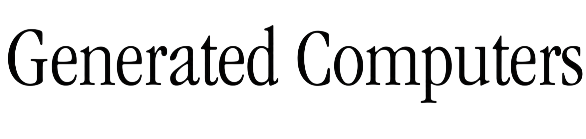

<p align="center">
  
</p>

<h1 align="center">Locals</h1>

<p align="center">
  AI coding assistants on your Mac, powered by a model that runs on your Mac.
</p>

<p align="center">
  <a href="LICENSE"></a>
  <a href="#getting-started"></a>
</p>

## What it is

Locals lets you use AI coding assistants such as OpenCode, Cline or Aider with an
AI model that runs entirely on your own Mac. Your code and your questions never
leave your computer, there is no account to create and nothing to pay per
request, and once the model is downloaded it runs without an internet
connection.

Modern assistants rarely ask one thing at a time. They run several helpers in
parallel, and some tasks use a whole team of agents. Locals answers all of
these requests together instead of one after another, which makes it about
three times faster than the usual way of running models on a Mac when several
requests arrive at once.

## Getting started

You need a Mac with Apple silicon (M1 or newer) and macOS 14 or newer. A Mac
with 16 GB of memory gives the best results; with 8 GB, use one of the smaller
models.

Open the Terminal app and run:

```bash
curl -LsSf https://raw.githubusercontent.com/Generated-Computers/Locals/main/install.sh | sh
```

Then start the coding assistant on one of your projects:

```bash
locals code ~/my-project
```

The first time, Locals downloads a model that suits your Mac (about 3 GB),
starts it in the background and opens the OpenCode assistant in your project.
From then on it starts in seconds. If you already use the uv package manager,
you can install with `uv tool install git+https://github.com/Generated-Computers/Locals`
instead.

## Use it with your tools

Locals works with the assistants and apps you may already have. For each one,
a single command starts Locals and connects the tool to it.

| If you use | Run |
|---|---|
| OpenCode | `locals code ~/my-project` |
| OpenHands | `locals launch openhands` |
| Cline or Kilo Code in the terminal | `locals launch cline` or `locals launch kilo` |
| OpenClaw or Hermes Agent | `locals launch openclaw` or `locals launch hermes` |
| Aider | `locals launch aider` |
| An editor: VS Code, Zed or JetBrains | `locals launch editor` |
| An app that works with Ollama | `locals launch ollama` |

For an editor, `locals launch editor` shows the address and model name to enter
in its AI settings. To see every supported tool, run `locals launch list`.

Locals keeps running in the background after you close a tool. Run
`locals status` to see what it is doing and `locals stop` to stop it.

## Choosing a model

Locals picks a model that fits your Mac's memory, so most people never need to
change it. If you want to try another one, add `--model` with its name:

```bash
locals code ~/my-project --model lfm
```

We gave each model the same thirteen everyday coding tasks, such as fixing a
bug, adding a command to a program, or writing a report from a spreadsheet:

| Model | Name to use | Download size | Tasks solved |
|---|---|---|---|
| Qwen3.5-4B (the default) | `qwen` | 2.8 GB | 11 of 13 |
| LFM2.5-2.6B | `lfm` | 1.6 GB | 11 of 13 |
| MiniCPM5-2B | `minicpm` | 1.4 GB | 9 of 13 |
| Gemma 4 E4B | `gemma` | 4.8 GB | 8 of 13 |
| Qwen3.8-27B | `qwen3.8` | 15 GB | needs 32 GB of memory |

The smaller models are good choices for a Mac with 8 GB of memory. LFM2.5
reached its score with its thinking mode on, which you get by choosing the
model name ending in `-thinking` in your tool.

You can also use other models published for Apple silicon on
[Hugging Face](https://huggingface.co/mlx-community), for example
`--model mlx-community/Qwen3.5-2B-MLX-4bit`. If a model is too big for your Mac,
Locals tells you before downloading it. Models in the GGUF format, which Ollama
and LM Studio use, do not run here, but Locals will point you to a version of
the same model that does.

## A team of agents on one task

Locals can also put several agents to work on a single task at the same time.
Each agent works on its own copy of your project, your tests check every change
they make, and your project is only updated once the tests pass.

```bash
locals run "write inventory.py, cli.py and tests for them" --dir ~/my-project
```

On tasks that span several files, a team solved all eight attempts in about
three minutes each, while a single agent solved four of eight and took longer.

## Using it from your own code

Locals understands the same requests as the OpenAI and Ollama services, so
programs and libraries written for them work with it unchanged. Start Locals
with `locals start`, then point your program at it:

```python
from openai import OpenAI

client = OpenAI(base_url="http://127.0.0.1:8321/v1", api_key="local")
reply = client.chat.completions.create(
    model="locals/qwen3.5-4b",
    messages=[{"role": "user", "content": "Write a haiku about the sea."}],
)
print(reply.choices[0].message.content)
```

The [examples](examples) folder has more, including structured answers in JSON
and tool calls.

## Privacy and safety

Everything runs on your Mac. Locals only accepts requests from apps on your own
computer, so a website you visit cannot use it. When a team of agents works on a
task, the commands they run can only change files in their own copy of your
project.

## If something does not work

Run `locals status`, or open http://127.0.0.1:8321 in your browser, to see whether
Locals is running and what it is doing. The first time Locals runs on a new Mac,
it spends a few minutes in the background tuning itself to your chip; you can
use it during that time, and it gets faster once it finishes.

Questions and problems are welcome as
[issues on GitHub](https://github.com/Generated-Computers/Locals/issues).

## For developers

```bash
git clone https://github.com/Generated-Computers/Locals
cd Locals
uv sync --extra dev
uv run pytest tests -q -m "not model"
```

See [CONTRIBUTING.md](CONTRIBUTING.md) for how the project is organized and tested.

## License

Locals is released under the MIT license. It is made by
[Generated Computers](https://github.com/Generated-Computers).
